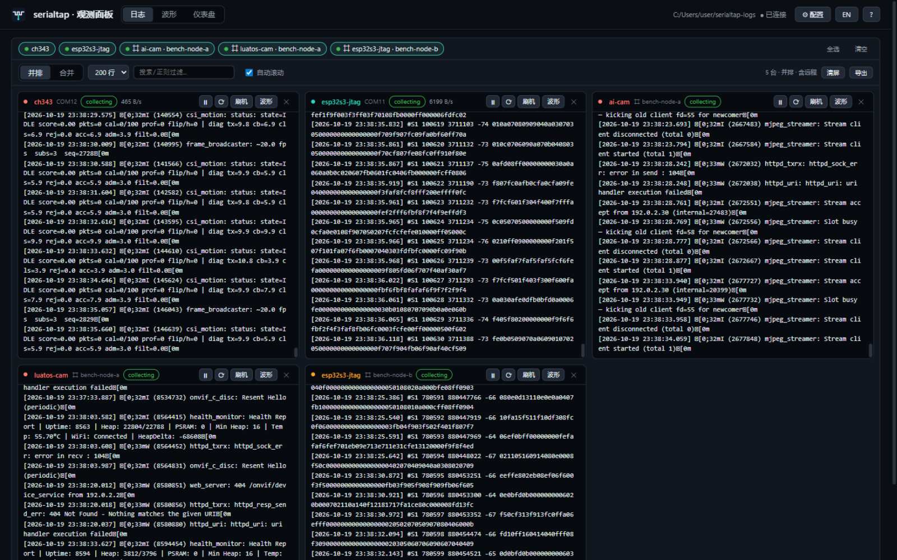
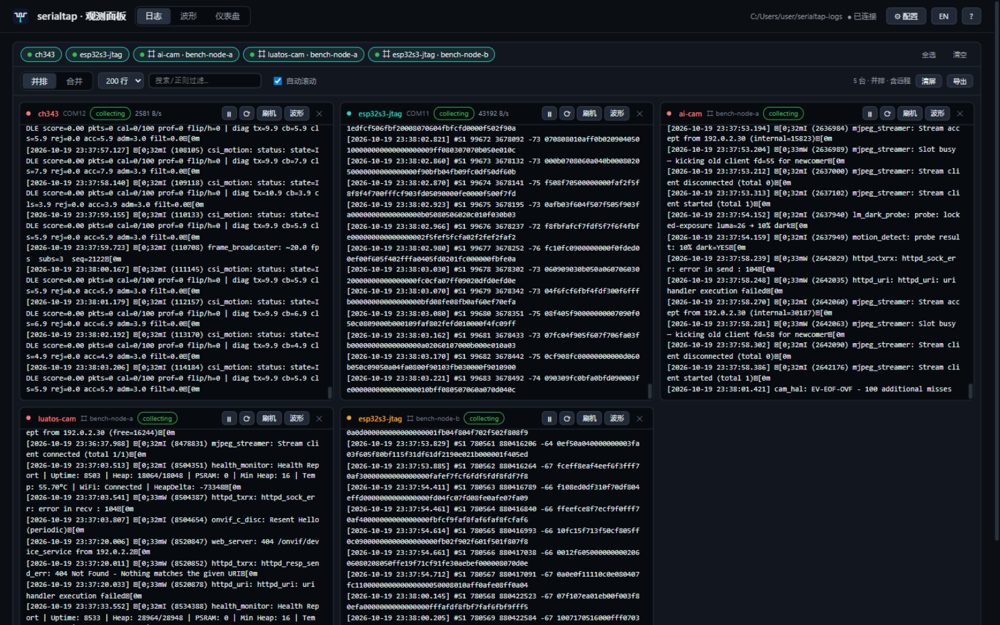
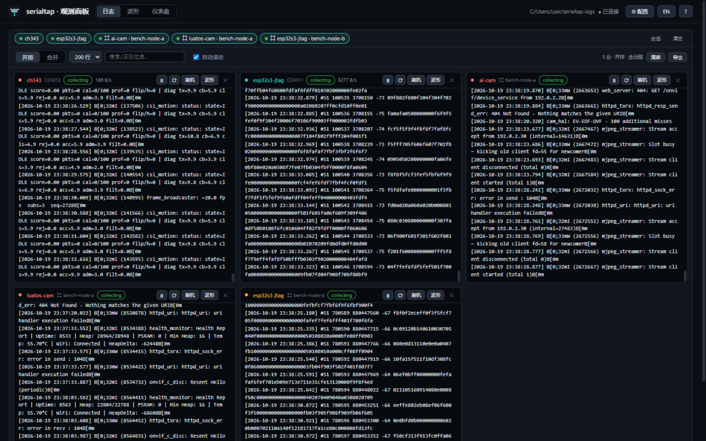
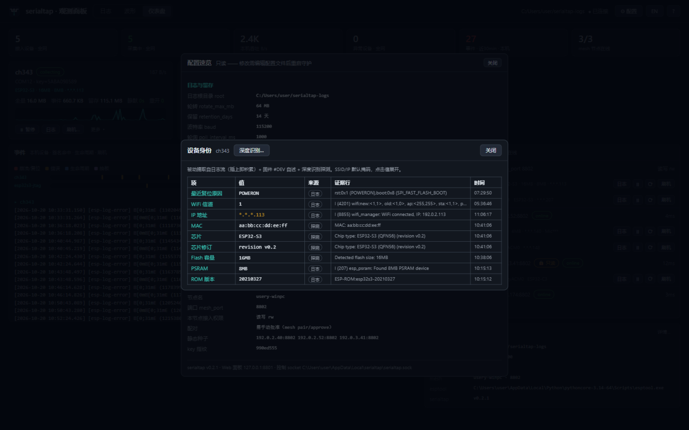
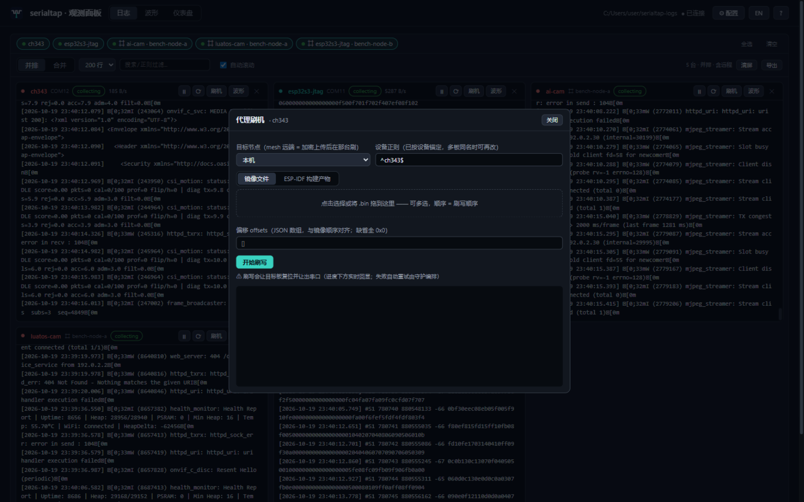
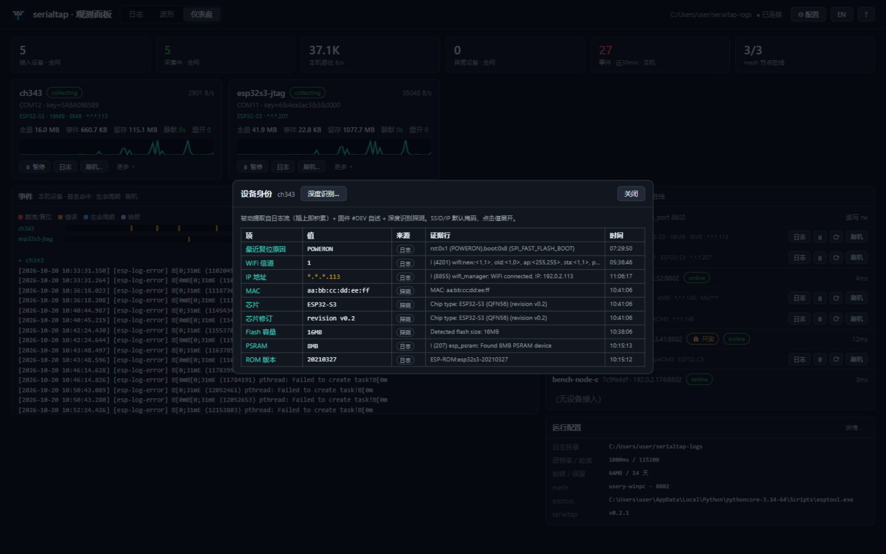
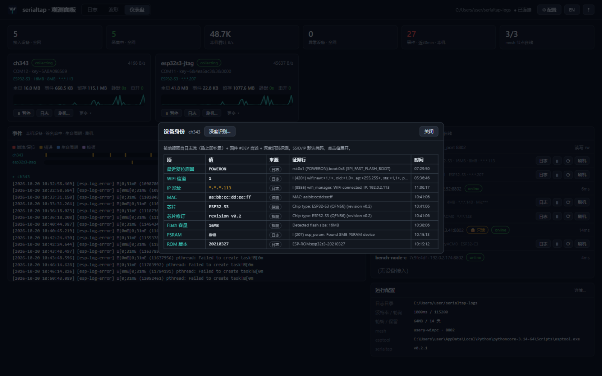

# Tutorial

The complete path from zero to "plug in a board, see logs, flash from the
browser". Full command/field references: [CLI reference](cli-reference.md) /
[Configuration](configuration.md); for the why behind the design see
[Architecture](architecture.md).

## 1. Up and running in five minutes

**Install** (from the [Releases](https://github.com/mickeyzzc/serialtap/releases)
page; built automatically on tags):

| Platform | Artifact | How |
|---|---|---|
| Windows | `serialtap-setup-<ver>.exe` | Next-next-next; a "serialtap tray" shortcut appears |
| Windows | `*-portable.zip` | Unzip, double-click `serialtap.exe` |
| macOS | `*.dmg` | Drag to Applications; double-click = menu-bar tray |
| Linux | `*.tar.gz` | Binary + systemd example; see [Deployment](deployment.md) |

**Open**: on Windows double-click the icon / tray shortcut — the tray appears
and auto-starts the daemon (a single-instance guard makes repeated launches
print a notice instead of stacking icons). Or run `serialtap run` in a
terminal.

**Watch logs**: open **http://127.0.0.1:8801/** in a browser — plug in any USB
serial board and a device card appears within a second, streaming
millisecond-timestamped logs. Everything also lands on disk under
`~/serialtap-logs/<device>/serial-YYYYMMDD.log` (full stream) and
`events-YYYYMMDD.log` (error signatures + lifecycle events).



> Antivirus products occasionally flag the unsigned Go binary on Windows: add
> `serialtap.exe` to the trust list (false positives can be reported to the
> vendor).

## 2. Panel tour

Three views (top bar, or keys `1/2/3`):

- **Logs**: side-by-side panes per device (including remote mesh devices);
  `/` focuses search, `F` freezes, auto-scroll toggle, line-count windowing,
  export. Card buttons: pause / soft-reconnect / flash / more (release, USB
  reset, identity, waveform live in the "more" menu).
- **Waveforms**: any `key=value` log line becomes a channel automatically
  (`T=28.1C`, `score=0.42` both parse), multi-device overlay; custom
  extraction regexes in the [waveform guide](waveform-guide.md).
- **Dashboard**: KPIs, per-device cards, running-config quick view; `c` or the
  ⚙ button opens the read-only config dialog (secrets show fingerprints only).







## 3. Daily operations

- **Pause/resume**: card ⏸ (panel checkbox, tray menu, and
  `serialtap pause <RE>` are equivalent; omit the regex for all devices).
- **Soft reconnect**: one close/open cycle at the serial layer
  (`serialtap reopen <RE>` / panel ⟳) without tearing down the collector —
  the fix for a "zombie" board.
- **USB reset**: restarts the USB device node via pnputil (Windows, UAC) — the
  fix for "the port vanished after reflashing".
- **Release**: `serialtap release <RE> --for 5m` yields the port to an
  external tool and re-acquires automatically (`--until-idle` on
  Linux/macOS reclaims when the port goes quiet).

**Flashing** (panel or `serialtap flash`): the dialog takes **image files**
(multiple .bins with offsets) or an **ESP-IDF build** (flasher_args.json
expands automatically) → confirm the plan → go. The daemon orchestrates
yield → esptool → re-acquire so nothing fights over the port, streaming
output back to the panel. Preview the exact command first with `--dry-run`:

```bash
serialtap flash ch343 firmware.bin@0x10000 --dry-run
serialtap flash ch343 --args-file build/flasher_args.json
```



## 4. Identity & boot self-test

- **Identity**: the card's identity line (model · firmware · flash · PSRAM…)
  accumulates automatically from logs / firmware self-description / deep
  identify; the detail table shows the evidence line behind every fact. Deep
  identify runs an esptool probe with one click (resets the board).



- **selftest**: `serialtap selftest [RE]` aggregates each board's latest boot
  `SELFTEST:` lines (board/flash/PSRAM/sensor/Wi-Fi scan) with common-sense
  hints — missing sensor, dead PSRAM, dead radio (aps=0) stand out at a
  glance. The firmware-side convention is documented in each firmware repo.

## 5. Multi-PC mesh

Several PCs, boards in any of them, one panel:

```bash
serialtap mesh keygen                      # passphrase (same on every machine)
# each machine's config.json:
#   "mesh_enabled": true, "mesh_key": "<passphrase>", "mesh_name": "bench-a"
serialtap mesh status                      # discovered nodes + auth state
serialtap mesh approve <node-id>           # approve a knock (or ✓ in the panel)
serialtap status --peer bench-a            # peer's devices
serialtap flash --peer bench-a <image>     # remote flash (encrypted upload)
serialtap at --peer bench-a <RE>           # remote serial console
```

A node can declare `"mesh_access": "ro"` — remote peers can only read; write
commands, tunnels and uploads are all rejected. Trust boundaries and pairing
semantics: [Architecture § Security model](architecture.md#security-model-overview).



## 6. Quick troubleshooting

| Symptom | Fix |
|---|---|
| "Nothing happens" on Windows open | Check the tray area; AV false positive → trust list |
| Repeated opens stack icons | v0.2.1 added the single-instance guard — upgrade |
| `run` says the control socket is taken | An instance is already running — just `status`; or `--sock` |
| Port won't open (EBUSY) | `release` it / `reopen` / USB reset |
| Mesh nodes don't see each other | Same `mesh_key`? AP isolation → `mesh_peers` static seeds |
| Where are my logs | `<root>/<device>/`, default `~/serialtap-logs` |

More: [Deployment (autostart/disk)](deployment.md) · [Control protocol
(scripting)](control-protocol.md) · [Contributing](../../CONTRIBUTING.md)
